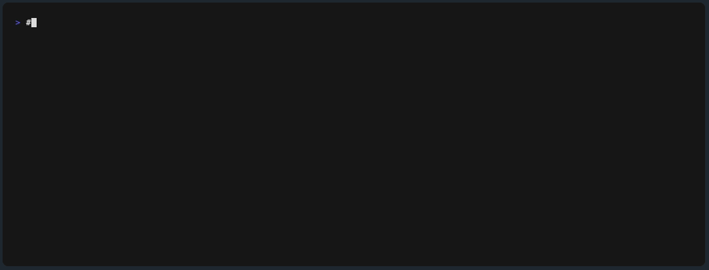

# git-scripts

<!-- prettier-ignore-start -->

[](https://github.com/piecioshka/git-scripts/actions/workflows/ci.yml)

<!-- prettier-ignore-end -->

🔨 Git utility scripts

## Installation

```bash
cd ~/projects/ # or any workspace what you use
git clone git@github.com:piecioshka/git-scripts.git

# Bash: please add to `~/.bash_profile`
export PATH="$HOME/projects/git-scripts/bin:$PATH"

# Fish: please add to `~/.config/fish/config.fish`
set -gx PATH $HOME/projects/git-scripts/bin/ $PATH
```

**TIP**: After changing the shell configuration, restart the terminal to apply the new settings.

## Commands

- `git bars <committer_author> <year[_month]>`
  - Displays the revision count for the specified period [[example](examples/git-bars.example)].
- `git changed-monorepo-packages [--oneline] [--base=main] [--folder=packages]`
  - Displays the packages with files changed since the `base` branch [[example](examples/git-changed-monorepo-packages.example)].
- `git changed-monorepo-packages-status [folder=packages] [base=main]`
  - Displays the names of the changed packages in one line, compared with the `base` branch.
- `git clone-path <repository_url> <path/to/folder-or-file>`
  - Clones the repository to the specified path.
- `git copy-branch-name`
  - Copies the current branch name to the clipboard [[example](examples/git-copy-branch-name.example)].
- `git fire <message>`
  - Creates a commit with all changes and pushes it to the origin [[example](examples/git-fire.example)].
- `git new-issue <issue_id>`
  - Useful for starting a new task: creates a worktree with a branch `<folder>-<issue_id>` from the default branch, an empty commit and a draft pull request (requires `gh`).
- `git projects-births [path=./]`
  - Displays the date and the author of the first commit of every project in the workspace, grouped by year [[example](examples/git-projects-births.example)].
- `git projects-daily-status [path=./]`
  - Displays the projects in the workspace with commits made today, and the number of changed files and lines [[example](examples/git-projects-daily-status.example)].
- `[DEBUG=true] git projects-push [path=./] [--verbose] [--jobs=N]`
  - Pushes every branch and tag of all projects in the workspace to the origin, `N` repositories at a time (default: 4) [[example](examples/git-projects-push.example)].
  - Pushes only the repositories that have work the origin is missing: commits ahead of the upstream, branches without an upstream (pushed with `-u`, so they are not reported again) and local tags. Branches and tags are pushed independently, so a branch the origin has moved past does not hold back the tags.
  - Skips files, bare repositories, directories that are not repositories and local-only repositories. A dirty or detached repository is pushed as usual, because `push` only reads the refs and never touches the working tree.
  - Exits with code `1` when any push fails; the output of the failed push is printed below the repository, and `--verbose` prints it for the successful ones too.
- `[DEBUG=true] git projects-update [path=./] [--verbose] [--jobs=N]`
  - Updates all projects in the workspace with `git pull --ff-only`, `N` repositories at a time (default: 4) [[example](examples/git-projects-update.example)].
  - Skips repositories that are dirty (modified tracked files), local-only, detached or without an upstream, and never leaves a repository in a merge or rebase; exits with code `1` when any update fails.
  - Reports the work that is missing from the origin: `[dirty N]` counts the modified tracked files, `[ahead N]` the commits of every local branch that its upstream does not have, and `[never pushed N]` the branches without an upstream; the branch names are listed below the repository. Repositories skipped by the update are reported too, but their numbers come from the refs of the last fetch, not from a fresh one.
- `git publish-branch`
  - Publishes the current branch to the origin and sets the upstream.
- `git repo-origin-url`
  - Displays the repository URL (`remote.origin.url`).
- `git run-on-nested-repos COMMAND [--max-depth=5] [--color=auto|always|never]`
  - Runs the specified command in all nested Git repositories, exits with code `1` when the command fails in any of them [[example](examples/git-run-on-nested-repos.example)].
  - Keeps the colors of the command output (e.g. `git branch`, `git status`) when printing to a terminal; `--color=always` keeps them in a pipe (`| less -R`), `--color=never` and `NO_COLOR` turn them off.
- `git setup`
  - Initializes the repository and creates the initial revision [[example](examples/git-setup.example)].
- `git squash-all-commits`
  - Removes the `.git/` directory and reinitializes the repository [[example](examples/git-squash-all-commits.example)].
- `git stats-between-tags [pattern] [--level=minor|major]`
  - Displays commits, added and removed lines between consecutive tags (`HEAD` is treated as a tag) [[example](examples/git-stats-between-tags.example)].
  - With `--level` only the tags of the given semver level are compared, so the changes of the skipped tags are merged into the surrounding range [[example](examples/git-stats-between-tags-level.example)].
- `git sync [--verbose]`
  - Synchronizes the repository with `origin`: fetches, pulls, and pushes **every** local branch and tag [[example](examples/git-sync.example)] [[example-2](examples/git-sync-verbose.example)].
  - Runs every step even when an earlier one fails, and exits with code `1` when any of them did.
- `git tags-recreate-versions-from-commits`
  - Creates the annotated tags `vX.Y.Z` for the commits whose subject is a version `X.Y.Z`, skipping the tags that already exist [[example](examples/git-tags-recreate-versions-from-commits.example)].
- `git tags-refresh`
  - Makes the local tags match the tags of `origin`: removes the local-only tags and moves the tags that point elsewhere.
- `git update-default-branch-master-to-main`
  - Changes the default branch from `master` to `main`.
- `git update-default-branch-master-to-main-in-workspace`
  - Changes the default branch from `master` to `main` in all your GitHub repositories, cloning each of them to a temporary directory (requires `gh` and `jq`); the archived ones are listed to change manually.
- `git user`
  - Displays the current user [[example](examples/git-user.example)].
- `git zip <name>`
  - Creates an archive from the current repository [[example](examples/git-zip.example)].

## Demos

Recorded with [vhs](https://github.com/charmbracelet/vhs).

### `git stats-between-tags`

```bash
git stats-between-tags
git stats-between-tags --level=minor
git stats-between-tags --level=major
```



## Development

```bash
npm install
./test.sh # shellcheck, unit tests and Prettier check
```

## Related projects

- https://github.com/aarek/git-tools
- https://github.com/ddollar/git-utils
- https://github.com/jwiegley/git-scripts
- https://github.com/knadh/git-bars
- https://github.com/nvie/gitflow

## License

[The MIT License](https://piecioshka.mit-license.org) @ 2026
